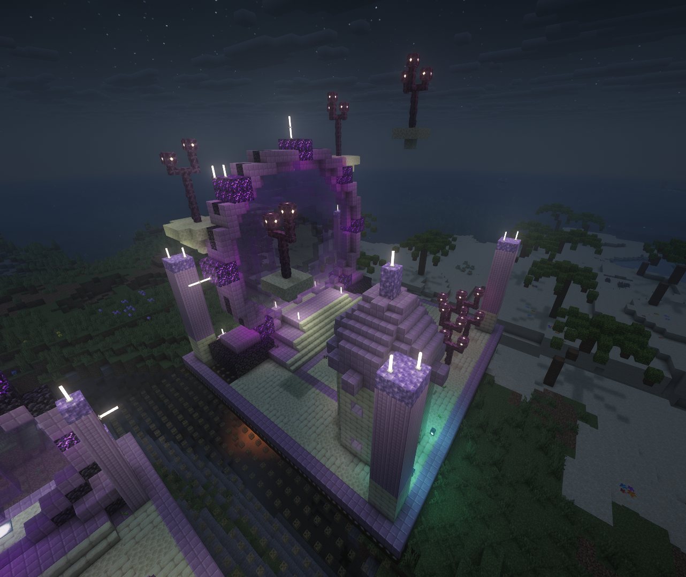
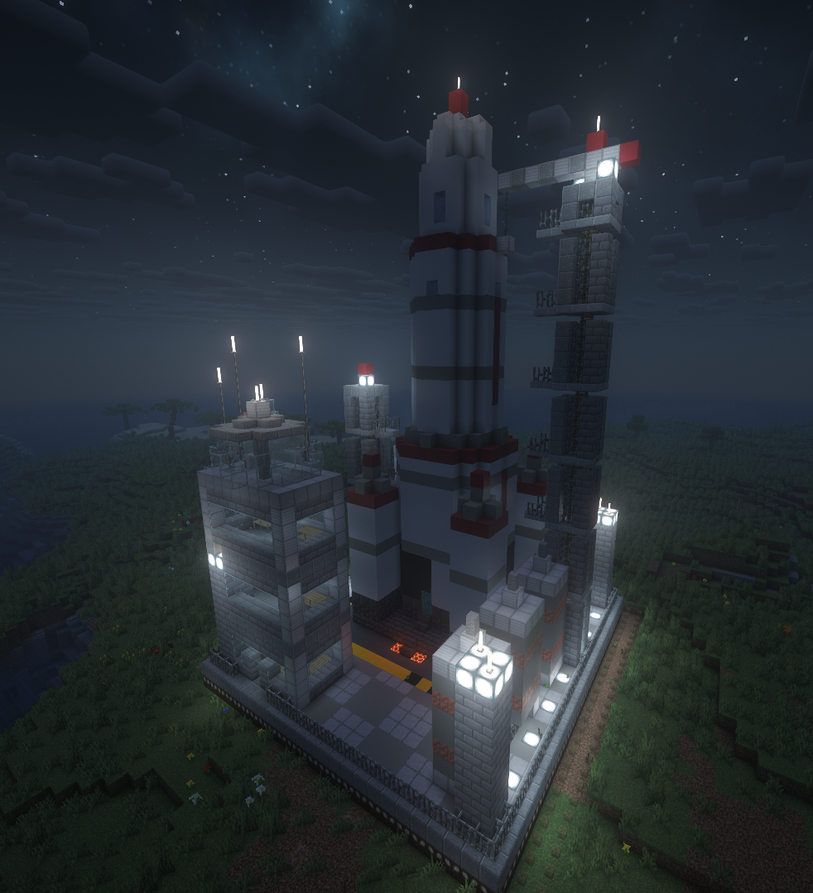
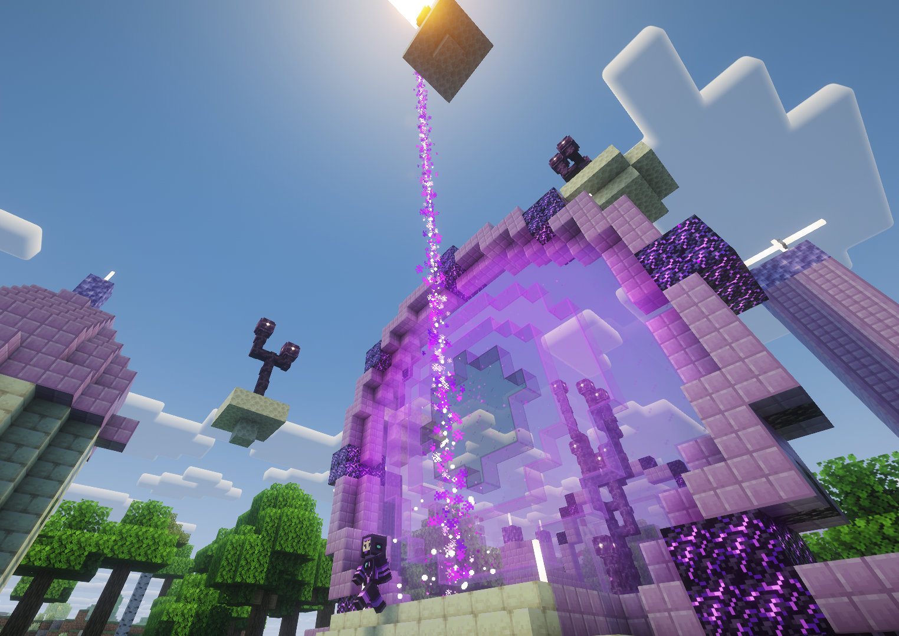
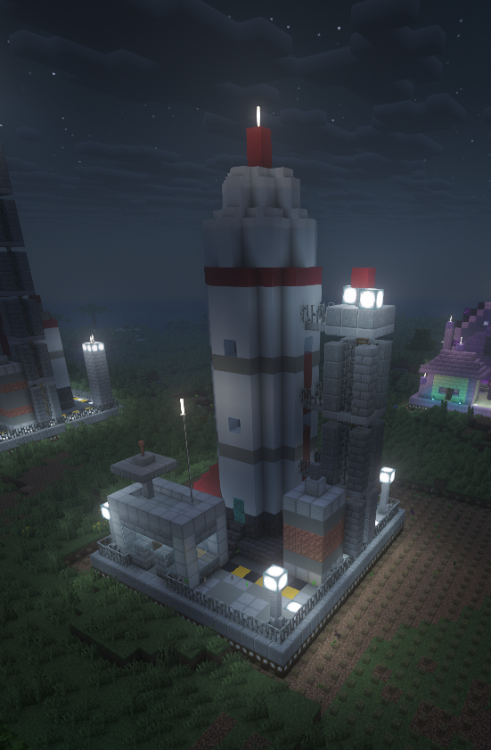

# Voyager - End Expeditions for MineColonies

*A new MineColonies profession that explores the End.*

> **0.4.0** - the whole expedition loop, both building looks, the research tree and the effects
> have been play-tested in single-player and LAN games since 0.2.0. This release is also tested
> on a headless dedicated server (NeoForge 21.1.249, MineColonies 1.1.1420); the
> [changelog](docs/CHANGELOG.md) lists what was run there. Please report bugs with your
> `logs/latest.log` (every expedition is written there with a `[Voyager]` prefix).

Voyager adds one building and one job to [MineColonies](https://www.curseforge.com/minecraft/mc-mods/minecolonies):
the **Departure Point** and the **Voyager** who works there. Every launch window the Voyager packs
rations and supplies, walks to the departure pad, lifts off in a rocket (or is beamed away through
an End Gate) and returns a while later with a haul from the End - end stone, chorus, purpur, ender
pearls, shulker shells, the occasional elytra... if they return at all. Endermen, shulkers and,
for the daring, the dragon are waiting out there.

Made by **Lovkar & Claude** for NeoForge 1.21.1.

|  |  |
| --- | --- |
| *An End Gate at night - the portal glows on its own, shaders or not* | *A level 5 Launchpad: three-stage rocket, crane tower, mission control* |
|  |  |
| *A Voyager leaves through the End Gate - the beam carries them up* | *Level 1 Launchpad: one rocket, one gantry, one control room* |

## Two looks, one building

The bundled *Voyager* structure pack contains both looks of the Departure Point, levels 1-5:

| Look | Style |
| --- | --- |
| **Launchpad** | A rocket on a hazard-striped pad with a control room, gantries and fuel tanks; by level 5 a three-stage rocket with boosters, a crane tower, mission control and a fuel farm |
| **End Gate** | A ring gate of purpur and obsidian with a glowing portal film, chorus trees and an observatory; by level 5 a monumental ring with floating chorus islets |

Pick either in the build tool (they are alternatives of the same "Departure Point" entry). Both
are the same building in every other respect, every level has the same footprint (so upgrades
never grow past the outline you placed) and the pack works next to any colony style.

## How it plays

1. Research **Reach for the Stars** (University → Technology, after *Open the Nether*; needs a
   Nether Mine).
2. Build a Departure Point and hire a Voyager. Adaptability shapes what they find, Agility the
   odds of coming home unhurt.
3. Stock the hut: a sword, a pickaxe, armor, rations (choose them in the Rations tab) and the
   expedition supplies - 64 cobblestone and 16 torches, used up by every trip, and 4 ender pearls,
   which only have to be in the Voyager's pack: they travel along and come home again (a server
   can scale these amounts, see [Server config](#server-config)).
4. Wait for a launch window: every three days at level 1-2, every two days at level 3-4, daily at
   level 5.
5. Read the **Expedition Log** in the hut to see what happened out there.

Higher levels bring bigger hauls and rarer finds (purpur and end rods from level 3, obsidian and
dragon's breath from level 4, a small chance of an elytra at level 5), but also more fights.
Every level also lets the Voyager carry better gear: iron tools at level 1, diamond at 2,
netherite at 3, anything (enchantments included) from level 4; armor follows the same ladder as
the guards'. Between fights the Voyager eats rations to recover, so a well-stocked pantry keeps
them alive.

### On a Launchpad

The Voyager climbs into the rocket through its hatch, the engines light and the rocket lifts off -
it is really gone until the expedition returns and lands again (every block of it is stowed by
the building and put back at touchdown). If the crew does not make it home the empty rocket lands
on its own.

### At an End Gate

The ring spins up a vortex, the Voyager vanishes in a flash and a purple beam carries them up
into the sky; before they return the beam comes down again. The portal film glows day and night
(the building keeps invisible light blocks behind the panes - the builder never has to find any)
and breathes End particles while a Voyager works there.

### When things go wrong

Not every Voyager comes home. A Voyager lost in the End gets a grave raised by the Departure
Point's console, so the Undertaker can bury - or resurrect - them like any other colonist.

A server can turn that off (`permanentDeath = false`, see [Server config](#server-config)): then
the blow that would have killed a Voyager is never dealt. They are driven back instead with a
quarter of their health and come home through the normal landing, stepping out with that quarter
(on the walk to the hut they heal like any hurt colonist), empty-handed (the cobblestone and torches
are used up and the finds are lost; the ender pearls come home in the pack, as after every trip) but
with all their gear - no grave, and nobody to mourn.

## Trophies from the End

Now and then a Voyager brings home something to remember a trip by - on top of the haul, never
instead of it.

- **Souvenirs** (any level, 1 completed trip in 10 by default): a keepsake named after one of
  sixteen places out in the End - a *Shard from the Hollow Spires*, a *Sprig from Chorus Reach*, a
  *Pebble from the Long Drop*. The tooltip tells the trip: who brought it home, which expedition
  of the Departure Point it was (from the Launchpad or the End Gate, and on which colony day) and
  what happened out there - "Fought 2 endermen and a shulker", or "A quiet crossing". Set it down
  on a shelf, a table or any block with a firm top and it stands on a little purpur stand; pick it
  up again and it is the same souvenir with the same story. An anvil can rename it - the story
  stays.
- **The Dragon's Wake.** A Voyager who meets the dragon (Dragon Hunt) and lives, and brings home a
  souvenir from that trip, brings a *Scale from the Dragon's Wake* - only then, and always then.
- **End-city books** (from a level 5 Departure Point, 1 completed trip in 20): an enchanted book
  with one enchantment from a list of ordinary ones - never Mending - at a random level.
- **A map of the End** (level 5, 3 completed trips in 100): a hand-drawn chart of the outer
  islands with the trip's story. A keepsake, not a working map: it never generates or loads a
  single chunk of the End.

Trophies are packed first, come home with the rest of the haul into the hut and are listed in the
Expedition Log; with Long-range Comms the colony hears about them ("Mira brought home a Shard from
the Hollow Spires"). A Voyager who is lost, or driven back (`permanentDeath = false`), brings none.
The chances and the book list are in the [server config](#server-config). Both trophies are also in
the creative tab with the hut blocks (as plain ones, without a story).

## Research

**Reach for the Stars** opens its own corner of the Technology tree (all need a Departure Point):

| Research | University | Effect |
|---|---|---|
| Void Insurance / II | 4 / 5 | Voyagers take 25% / 50% less damage in the End |
| Starlight Navigation | 4 | one more expedition per launch window |
| Rapid Refit | 5 | expeditions take 25% less time |
| Buddy System | 5 | a second Voyager per Departure Point (a Launchpad's crews take turns with the rocket) |
| Ender Harvest | 4 | every enderman beaten leaves an extra ender pearl |
| Shulker Whisperer | 4 | every shulker beaten leaves an extra shell |
| Dragon Hunt | 5 | level 5 Voyagers may run into the dragon (1 in 10 trips by default) - a dragon head and dragon's breath for the survivors |
| Long-range Comms | 4 | the Voyager reports to the colony chat while away |
| Return to Sender | 5 | a lost Voyager's gear comes back to the hut |

## The Observatory and the Photo Booth (0.3.0)

Two more buildings, built around [Exposure](https://www.curseforge.com/minecraft/mc-mods/exposure)
and its Space and Expanded add-ons. Neither needs the other, and both are optional.

**The Observatory** — an *Astronomer* who works the night: at dusk they walk out to the instrument
(a telescope, an armillary sphere, a gnomon, a ring - five looks), keep the watch while the sky is
clear, and come home at dawn with a plate. What is in the sky comes from Exposure: Space's cosmic
objects (or any datapack of them); the darkroom develops the plates into prints and genuine
Exposure photographs, the colony is paid the objects' own rewards, and the building runs its own
research — *studies* paid for in nights of watching, some of which reach the Voyager. The
astronomer lives at the Observatory. When there is a hill, ridge or cliff with a clear sky within
forty blocks they keep the watch from **the lookout** instead, with the colony's camera, and bring
back a real photograph of the night sky with the object they caught in it; a setting sends one or
two **guards** from the nearest towers out with them to stand watch until the plate is taken.

**The Photo Booth** — a *Photographer* who crafts everything Exposure makes (film, cameras, stands,
frames, albums, flashes) and, when the bench is quiet, takes photographs of the colony: drawn ray
by ray on the server out of the world's own map colours, with the colonists in front of the lens in
the picture, shaded by the light, through whatever film, lens, filter and flash the colony fitted
to its camera. The booth's settings pick the **film** (black and white, colour, high-sensitivity,
and with Expanded high-resolution, which makes the pictures twice as sharp) and the **filter**
(red, orange, yellow, green, blue, sepia - or, with Expanded, pencil sketch, outline, soft focus,
mirror, faded and vivid) that the photographer loads and fits before every picture; a full roll
of his own pictures is used up, since they are all printed already. Every building the builder finishes is photographed for the **colony chronicle**, an
album on the shelf signed as a volume when it is full; between times he walks round town for a
**portrait** of a colonist out of doors or a **view** of one of its buildings; from level 2
**visitors come in for a portrait** and, with Trade Post for MineColonies installed, pay for it in coins. Both huts have
photograph frames on their walls and both workers hang their pictures in them - an empty frame
first, then over the oldest picture, whose print goes on the shelf - so the walls always show the
newest work: the astronomer's night-sky prints and lookout photographs in the study, the
photographer's portraits and views on the gallery wall.

## Requirements

- Minecraft 1.21.1, NeoForge 21.1.x
- MineColonies 1.1.1300+ (tested with 1.1.1368 and 1.1.1420) and Structurize
- Optional: Exposure 1.9+ (the Photo Booth, and the Observatory's photographs), Exposure: Space
  (the sky itself), Exposure: Expanded (filters), Trade Post for MineColonies (the visitors' coins)

### What needs what

- **Departure Point and Voyagers** (the End expeditions) - only MineColonies and Structurize. They
  work exactly as in 0.2.0 whatever else is or is not installed.
- **Observatory and Astronomer** - the sky is Exposure: Space's: without it the astronomer keeps the
  watch over an empty sky (nothing caught, nothing paid, the sky book stays empty, the lens studies
  cannot be bought). Exposure itself makes the pictures: without it the plates, the rewards and the
  sky book still work, but there is no darkroom photograph, no lookout photograph and no frames on
  the walls. Exposure: Expanded supplies the first ("Bad") lens; Exposure: Space lists it as required.
- **Photo Booth and Photographer** - needs Exposure, full stop: without it the building can be placed
  and the photographer hired, but there are no recipes, no camera, no photographs, no chronicle and
  no visitor portraits. Trade Post for MineColonies only adds the coins - without it visitors still
  sit for a portrait, nobody pays for it.
- **Colonist Errands 2.2.0+** is optional and gives the astronomer and the photographer their voice.

Short version: install Exposure, Exposure: Space and Exposure: Expanded if you want the Observatory
and the Photo Booth; the End expeditions never needed them.

Optional: with [Colonist Errands](https://www.curseforge.com/minecraft/mc-mods/colonist-errands)
2.1.0+ and Talking Colonists, Voyagers can tell you about their last expedition and chat with
their crewmate while they wait for the next launch window; with Colonist Errands 2.2.0+ the
astronomer and the photographer know their work too - what the Observatory has in its sky book,
what they caught tonight, who sat for a portrait.

## Installation

Drop `voyager-<version>.jar` into your `mods` folder next to MineColonies and Structurize. The
structure pack is inside the jar; nothing else to install. Adding the mod to an existing world is
fine - the research appears in the University and the Departure Point in the build tool.

## Server config

Voyager has a server config, `voyager-server.toml`. NeoForge writes it with the defaults below the
first time a world starts, in the `config` folder of the server (or of the game, in single-player);
a copy in a world's `serverconfig` folder overrides it for that world. The server sends its values
to every player who joins. The defaults of the `expeditions` section play exactly like 0.3.9.

| Key | Default | Range | What it does |
|---|---|---|---|
| `expeditions.tripsPerLaunchWindow` | 1 | 1-10 | expeditions per launch window per Voyager; Starlight Navigation and Launch Window still add one each |
| `expeditions.rationsPerVoyager` | 16 | 1-64 | rations each Voyager packs for a trip; the hut asks for food while it holds fewer than this per Voyager |
| `expeditions.supplyMultiplier` | 1.0 | 0.25-4.0 | scales every supply amount of the expedition plans (rounded up, at least 1): what the hut requests, what must be in stock and what a launch uses up |
| `expeditions.tripLengthMultiplier` | 1.0 | 0.1-10.0 | scales the time a Voyager is away; Rapid Refit and Star Charts still shorten it |
| `expeditions.dragonChance` | 0.10 | 0-1 | chance per level-5 expedition with Dragon Hunt that the dragon is on the itinerary |
| `expeditions.permanentDeath` | true | true / false | `false`: a blow that would kill a Voyager drives them back instead - home wounded and empty-handed, with their gear, no grave |
| `rewards.souvenirChance` | 0.10 | 0-1 | chance per completed expedition of a souvenir from the End |
| `rewards.endCityBookChance` | 0.05 | 0-1 | chance per completed level-5 expedition of an End-city enchanted book |
| `rewards.endMapChance` | 0.03 | 0-1 | chance per completed level-5 expedition of a hand-drawn map of the End |
| `rewards.bookEnchantments` | 16 ordinary enchantments | any enchantment ids | what an End-city book can carry: protection, fire_protection, blast_protection, projectile_protection, feather_falling, respiration, depth_strider, unbreaking, efficiency, fortune, silk_touch, sharpness, smite, looting, power and punch (all `minecraft:`); no Mending, no curse. An id that names no enchantment in the world is left out, with one warning in the log |

The supply *list* of an expedition is not in the config: it is the datapack recipes
`data/voyager/crafterrecipes/voyager/trip1.json` to `trip5.json` (one per building level). To change
what a trip costs, replace those files with a datapack of your own; the multiplier then scales
whatever they ask for.

## Building from source

See [BUILDING.md](BUILDING.md). Design notes and the roadmap live in [docs/IDEAS.md](docs/IDEAS.md),
the version history in [docs/CHANGELOG.md](docs/CHANGELOG.md).

## License

GPL-3.0-or-later. The Voyager structure pack (`resources/blueprints/voyager/`), the suit textures
and the sounds are part of the mod and share its license.
